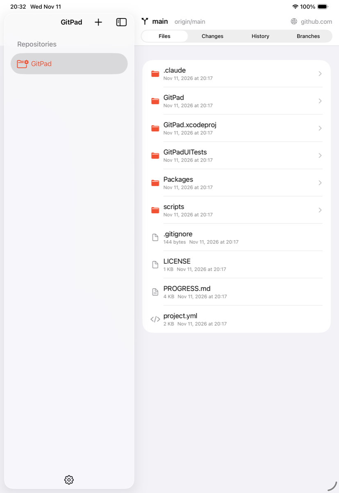
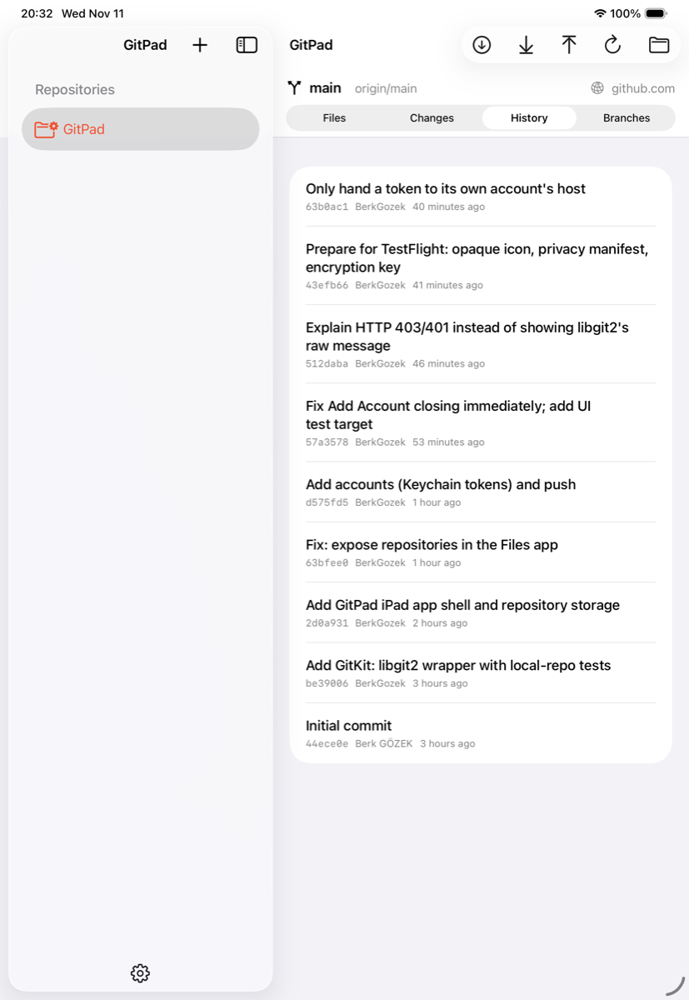
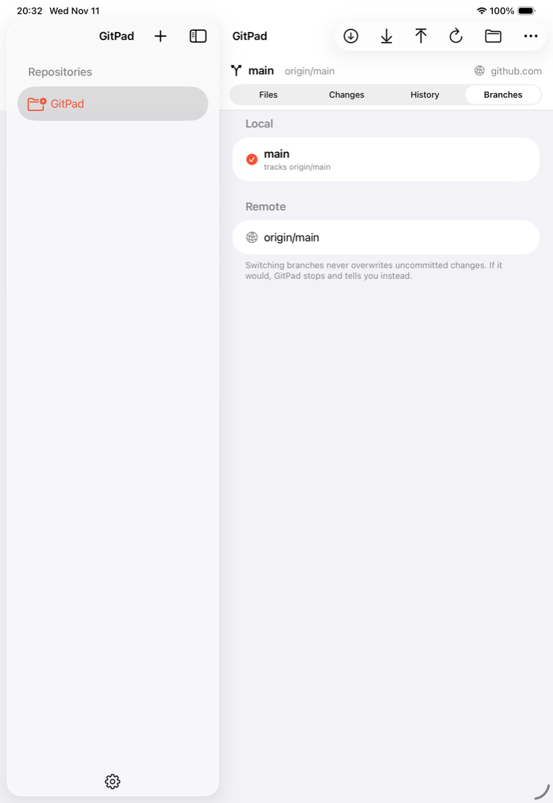
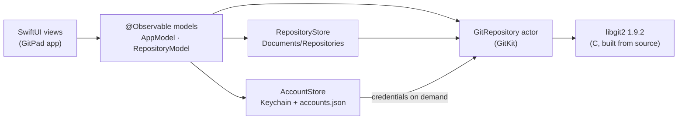

<div align="center">


# GitPad

**A native Git client for iPad.** Clone, edit, commit, push, and pull, with no Mac required.


</div>

<table>
  <tr>
    <td></td>
    <td></td>
    <td></td>
  </tr>
  <tr>
    <td align="center"><sub>Files</sub></td>
    <td align="center"><sub>History</sub></td>
    <td align="center"><sub>Branches</sub></td>
  </tr>
</table>

## Why GitPad

Your repositories are **real folders on your iPad**, stored where the Files app can see them.
Open a file in any editor, save it, switch back to GitPad, and the change is waiting in
**Changes**, ready to stage, commit, and push. Everything except fetch/pull/push works offline.

```
Files → On My iPad → GitPad → Repositories → your-project/
```

## Features

| | |
|---|---|
| 📥 **Clone** | Public and private HTTPS repositories from GitHub, GitLab, Bitbucket, or any Git server, with progress and a Stop button |
| 📂 **Files integration** | Working copies live in the app's Documents folder, so other apps can open and edit them in place |
| ✏️ **Changes** | Staged and unstaged files, per-file diffs, stage/unstage with a tap or swipe, commit |
| 🔄 **Sync** | Fetch, pull (fast-forward or merge), and push, with ahead/behind counts in the header |
| 🌿 **Branches** | Create, switch, and check out remote branches |
| 🕒 **History** | Commit log with authors, dates, and merge markers |
| ⚔️ **Conflicts** | Conflicted files are listed; resolve in any editor, mark resolved, commit, or abort the merge |
| 🔐 **Accounts** | Several accounts per host, tokens in the Keychain, one account chosen per repository |
| ⌨️ **Keyboard** | ⇧⌘N clone · ⌥⌘F fetch · ⇧⌘P pull · ⇧⌘U push · ⌘R refresh · ⌘↩ commit |

## Built to not lose your work

- **Never force-pushes.** If the remote has new commits, GitPad explains it and offers to pull first.
- **Never silently overwrites.** Pulls and branch switches use a *safe* checkout: if they would
  overwrite an uncommitted change, nothing changes and you're told why.
- **No half-finished clones.** Clones download into a hidden staging folder and appear only once
  complete. A cancelled or interrupted clone leaves nothing behind.
- **Destructive actions ask first.** Deleting a repository or aborting a merge always confirms
  and says what will be lost.

## Accounts and tokens

Public repositories need no account for cloning and pulling. Pushing, and private repositories,
need a token: **Settings → Accounts → Add Account**.

| Service | Create a token | Permissions for push |
|---|---|---|
| GitHub | Settings → Developer settings → **Fine-grained tokens** | Repository access: your repos · **Contents: Read and write** |
| GitLab | User settings → **Access tokens** | `read_repository`, `write_repository` |
| Bitbucket | Atlassian account → **API tokens** | Repository read + write |
| Other | Your server's docs | Whatever allows HTTPS push |

> [!TIP]
> New GitHub fine-grained tokens are **read-only by default**. If a push fails with
> *"isn't allowed to push here (HTTP 403)"*, edit the token on GitHub and set
> **Contents → Read and write**. The token itself doesn't change.

**Where the token goes:**

- Stored **only in the iPad's Keychain**, marked *this device only*, so it isn't backed up or synced
- Sent **only** to the Git server of its own account's host (redirects to other hosts get nothing), and once to that service's API to check it when you add the account
- **Never** written to repository settings, remote URLs, logs, or error messages
- No analytics, no telemetry, and no GitPad server

## How it works



| Layer | Where | What it does |
|---|---|---|
| **GitKit** | `Packages/GitPadKit/Sources/GitKit` | Swift wrapper over libgit2. Each repository is an `actor` on its own serial queue, because libgit2 calls block and must not tie up Swift's shared thread pool. Typed errors, redaction, cancellation, progress |
| **GitPadCore** | `Packages/GitPadKit/Sources/GitPadCore` | Repository storage (staging → move), accounts and Keychain, token checks |
| **App** | `GitPad/` | SwiftUI: `NavigationSplitView` sidebar, repository tabs, sheets for clone/push/settings |

**Why libgit2?** iPadOS has no `git` command and apps can't run other programs, so Git has to run
inside the app. libgit2 is the mature, widely used library for exactly that. It's compiled from
source through SwiftPM using Apple's TLS, with no prebuilt binaries.

**Why no File Provider extension?** Sharing the app's Documents folder already makes repositories
visible and editable in Files. A File Provider would add a second process and a lot of
complexity for no gain here.

## Building

**Requirements:** Xcode 26+, [XcodeGen](https://github.com/yonaskolb/XcodeGen) (`brew install xcodegen`),
an iPad on iPadOS 26+ (or the simulator).

```sh
git clone https://github.com/BerkGozek/GitPad.git
cd GitPad
xcodegen generate          # creates GitPad.xcodeproj from project.yml
open GitPad.xcodeproj
```

Pick your team under **Signing & Capabilities**, select your iPad, and press **⌘R**.

> [!IMPORTANT]
> Keep the bundle ID and team the same between builds. A different one makes iPadOS install a
> separate app, and **deleting GitPad deletes the repositories stored in it**, including anything
> you haven't pushed.

## Testing

```sh
# Git engine, storage, accounts (macOS, ~1 s)
swift test --package-path Packages/GitPadKit

# UI tests on the iPad simulator
xcodebuild -project GitPad.xcodeproj -scheme GitPad \
  -destination 'platform=iOS Simulator,name=iPad Pro 11-inch (M5)' test

# Optional: real HTTPS round trip against a throwaway private GitHub repo
GITPAD_LIVE_TESTS=1 GITPAD_TEST_REPO=https://github.com/you/sandbox.git \
GITPAD_TEST_TOKEN=… swift test --package-path Packages/GitPadKit --filter LiveGitHubTests
```

The package tests build temporary local repositories (a bare "remote" plus clones) and cover clone,
staging, commits, push/pull, rejected pushes, conflicts, branch safety, cancelled clones,
persistence, and token handling. Results are tracked in [`PROGRESS.md`](PROGRESS.md).

## Current limitations

- **HTTPS only.** SSH remotes aren't supported yet.
- **No built-in editor.** Edit files with any app through Files; GitPad picks up the changes when you return.
- **Conflicts are resolved by hand.** Edit the conflict markers in an editor, then mark the file resolved. There's no visual merge tool yet.
- **Sync runs while GitPad is open.** iPadOS may pause a clone or push if you leave the app.
- **No sign-in with GitHub yet.** Use a token (see above).
- **Not yet supported:** stash, rebase, tags, submodules, Git LFS.
- **Opening a whole repository folder in other apps** depends on the app supporting folders from Files; individual files always work.

## Roadmap

- [ ] Sign in with GitHub (OAuth device flow)
- [ ] SSH keys
- [ ] Built-in code editor
- [ ] Visual diff and merge-conflict editor
- [ ] Commit graph and search
- [ ] Branch rename/delete, stash, rebase, tags
- [ ] Git LFS and submodules
- [ ] Background clone/push via `BGContinuedProcessingTask`

## License

GitPad is released under the [MIT License](LICENSE).
It includes [libgit2](https://github.com/libgit2/libgit2) (GPL v2 with linking exception) and the
libraries bundled with it. See [THIRD_PARTY_NOTICES.md](THIRD_PARTY_NOTICES.md), or
**Settings → Acknowledgements** in the app.
